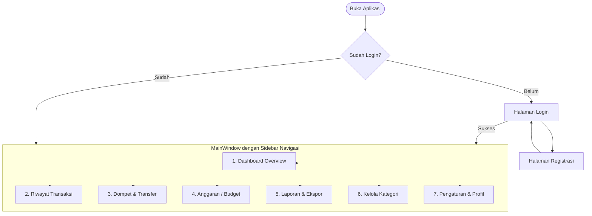
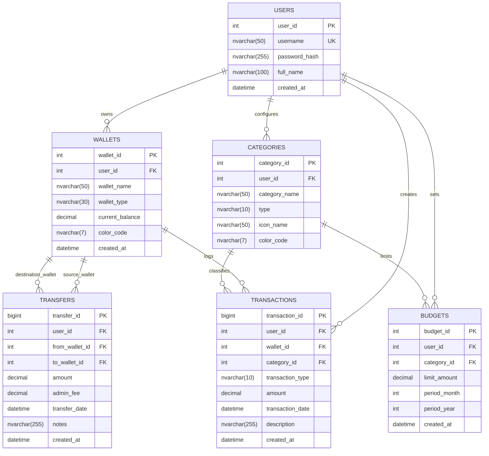

# PRODUCT REQUIREMENT DOCUMENT (PRD)
## DOMPETKU – Sistem Informasi Keuangan Pribadi (Desktop Application)

---

### Informasi Dokumen
- **Nama Proyek:** DOMPETKU (Sistem Informasi Keuangan Pribadi)
- **Tipe Proyek:** Evaluasi Tengah Semester (ETS) - Pemrograman Berbasis Kerangka Kerja (PBKK)
- **Target Platform:** Desktop Windows (Windows 10/11)
- **Framework & Bahasa:** .NET 8.0 / .NET Framework, C#, XAML (WPF - Windows Presentation Foundation)
- **Arsitektur:** Layered Architecture / MVVM Pattern
- **Akses Data:** ADO.NET (`SqlConnection`, `SqlCommand`, `SqlDataReader`, `SqlTransaction`)
- **Basis Data:** Microsoft SQL Server (Express / Developer Edition)
- **Status Dokumen:** Draft v1.0 (PRD First - Siap Review)

---

## 1. Latar Belakang dan Permasalahan

### 1.1 Latar Belakang
Pengelolaan finansial pribadi merupakan salah satu faktor krusial dalam menjaga stabilitas ekonomi individu, mahasiswa, maupun profesional muda. Banyak individu mengalami fenomena *leakage spending* (pengeluaran impulsif tanpa disadari) dan kesulitan melacak ke mana arus kas bulanan mereka mengalir. 

Aplikasi berbasis web atau spreadsheet (seperti Microsoft Excel) seringkali dirasa kurang intuitif untuk pencatatan harian cepat secara offline, sedangkan aplikasi mobile sering dibatasi oleh kenyamanan input data massal atau visualisasi dashboard di layar kecil. Oleh karena itu, diperlukan aplikasi desktop Windows berbasis **WPF (Windows Presentation Foundation)** bernama **DOMPETKU** yang responsif, terstruktur, aman, dan bekerja optimal di lingkungan lokal menggunakan **SQL Server** dan **ADO.NET**.

### 1.2 Identifikasi Masalah
1. **Pencatatan yang Terfragmentasi:** Pengguna sering mencatat pemasukan dan pengeluaran pada catatan manual (kertas, chat note, spreadsheet acak) yang rawan hilang dan sulit dikonsolidasi.
2. **Tidak Adanya Kontrol Anggaran (Budgeting):** Pengguna tidak memiliki sistem peringatan (*warning alert*) ketika belanja suatu kategori (misal: hiburan, makan di luar) mendekati atau melampaui batas anggaran bulanan.
3. **Visibilitas Finansial Rendah:** Ketiadaan rekapitulasi visual grafik arus kas (*cash flow*) dan tren pengeluaran harian/bulanan.
4. **Kekhawatiran Privasi Data:** Kebutuhan pengguna untuk menyimpan data finansial secara lokal tanpa ketergantungan koneksi internet dan cloud pihak ketiga yang rentan bocor.

---

## 2. Sasaran, Indikator, dan Batasan

### 2.1 Sasaran Produk (Goals)
- Menyediakan aplikasi desktop personal finance yang handal, cepat, dan mudah digunakan untuk mencatat, mengelola, serta menganalisis kondisi keuangan harian.
- Mengimplementasikan konsep tata kelola data transaksi yang bersih, akurat, dan memiliki integritas data tinggi (*ACID compliance*) menggunakan ADO.NET dan SQL Server.
- Memenuhi seluruh standar teknis dan fungsional penilaian tugas evaluasi pemrograman kerangka kerja desktop.

### 2.2 Indikator Keberhasilan (Success Metrics / KPIs)
- **Efisiensi Input:** Pengguna dapat mencatat satu transaksi baru (pemasukan/pengeluaran) dalam waktu kurang dari 15 detik.
- **Integritas Saldo:** Saldo akun/dompet terhitung secara konsisten 100% tepat terhadap riwayat transaksi dan transfer antar-akun.
- **Respon Aplikasi:** Transaksi pencatatan, mutasi, dan pencarian data dalam basis data dieksekusi di bawah 500 ms.
- **Budget Tracking:** Sistem mampu memicu notifikasi visual ketika transaksi menyebabkan pengeluaran mencapai $\ge 80\%$ dan $> 100\%$ dari pagu anggaran aktif.

### 2.3 Batasan Produk (Constraints & Assumptions)
- **Platform:** Khusus OS Windows (Windows 10 versi 1903+ / Windows 11).
- **Mode Eksekusi:** Single-user / local desktop environment (autentikasi akun lokal atau single-profile per database instance).
- **Mata Uang:** Default Rupiah (IDR) dengan format penomoran Indonesia (`Rp 1.000.000,00`).
- **Database Engine:** Microsoft SQL Server (LocalDB / Express Edition) yang berjalan secara lokal atau local network.
- **Akses Data Murni ADO.NET:** Menghindari Entity Framework / ORM berat demi mendemonstrasikan penguasaan koneksi native ADO.NET, parametrized queries, dan stored procedures / raw SQL yang aman dari SQL Injection.

---

## 3. Ruang Lingkup Produk (Product Scope)

### 3.1 In-Scope (Fitur yang Dibangun)
1. **Modul Autentikasi & Profil Pengguna:**
   - Registrasi & Login akun lokal dengan enkripsi/hashing password (misal: SHA-256 / BCrypt).
   - Pengaturan profil dasar pengguna.
2. **Modul Manajemen Dompet / Akun Finansial (Wallets/Accounts):**
   - Mendukung banyak jenis dompet (Kas Tunai, Rekening Bank BCA/Mandiri/BRI, E-Wallet GoPay/OVO/ShopeePay).
   - Fitur transfer saldo antar-dompet (*Inter-account transfer*) dengan pencatatan mutasi ganda otomatis (*debit-credit balance*).
3. **Modul Kategori Transaksi:**
   - Kategori dinamis terpisah untuk Pemasukan (Gaji, Bonus, Investasi) dan Pengeluaran (Makanan, Transport, Tagihan, Hiburan, Belanja).
   - Pengelompokan dengan kode warna dan ikon.
4. **Modul Transaksi (Income & Expense Ledger):**
   - CRUD (Create, Read, Update, Delete) data transaksi.
   - Filter tanggal (hari ini, minggu ini, bulan ini, custom range), filter kategori, dan pencarian teks deskripsi.
5. **Modul Anggaran / Budgeting:**
   - Penetapan pagu anggaran per kategori per bulan.
   - Progress bar realisasi anggaran beserta indikator status (*Safe*, *Warning*, *Exceeded*).
6. **Modul Laporan & Dashboard Analitik:**
   - Ringkasan total saldo, total pemasukan bulan berjalan, total pengeluaran bulan berjalan, dan arus kas bersih (*Net Cash Flow*).
   - Grafik interaktif: Komposisi pengeluaran per kategori (Pie/Doughnut Chart) dan tren kas bulanan.
   - Fitur ekspor riwayat mutasi transaksi ke format CSV / Excel.

### 3.2 Out-of-Scope (Bukan Prioritas ETS)
- Integrasi otomatis dengan Open Banking API / web scraping mutasi bank resmi.
- Sinkronisasi cloud multi-device otomatis (mobile companion app).
- Multi-currency dinamis dengan kurs forex live via internet.
- Fitur investasi kompleks (pencatatan portofolio saham, dividen yield, reksadana NAV live).

---

## 4. Struktur Navigasi dan Halaman

### 4.1 Diagram Alur Aplikasi (App Flow)


### 4.2 Struktur Tampilan Antarmuka (Shell Layout)
Antarmuka menggunakan pola modern desktop layout:
- **Left Sidebar Navigation:** Menampung logo "DOMPETKU", identitas user aktif, menu navigasi utama, indikator koneksi database, dan tombol logout.
- **Top Header Bar:** Judul halaman aktif, tanggal sistem, tombol aksi cepat (*Quick Add Transaction* Modal), serta tombol minimize/maximize/close custom window.
- **Main Content Host:** Menggunakan `Frame` atau dynamic `ContentControl` untuk merender UserControl halaman yang dipilih secara *seamless*.

---

## 5. Kebutuhan Fungsional (Functional Requirements)

| ID | Modul | Deskripsi Kebutuhan |
| :--- | :--- | :--- |
| **FR-01** | Autentikasi | Pengguna dapat mendaftar dengan nama lengkap, username, dan password. Password wajib disimpan dalam bentuk hash (bukan plain text). |
| **FR-02** | Autentikasi | Pengguna dapat login dan logout dari aplikasi dengan validasi kredensial ke SQL Server. |
| **FR-03** | Dompet / Akun | Pengguna dapat membuat beberapa dompet (e.g., "Tunai", "BCA", "GoPay") dengan saldo awal (*initial balance*). |
| **FR-04** | Dompet / Akun | Pengguna dapat melakukan transfer antar-dompet dengan pemotongan saldo dompet asal dan penambahan saldo dompet tujuan dalam satu `SqlTransaction`. |
| **FR-05** | Kategori | Pengguna dapat menambah, mengedit, dan menghapus kategori transaksi untuk tipe Pemasukan maupun Pengeluaran. |
| **FR-06** | Transaksi | Pengguna dapat mencatat transaksi pemasukan/pengeluaran dengan atribut: Tanggal, Dompet Terkait, Kategori, Jumlah Uang (Nominal), dan Catatan/Keterangan. |
| **FR-07** | Transaksi | Sistem secara otomatis mengupdate saldo dompet yang bersangkutan setiap kali transaksi dibuat, diubah, atau dihapus. |
| **FR-08** | Transaksi | Pengguna dapat mencari dan memfilter transaksi berdasarkan rentang tanggal, kategori, dompet, dan kata kunci catatan. |
| **FR-09** | Anggaran | Pengguna dapat menetapkan limit anggaran per kategori untuk periode bulan tertentu (misal: "Makan & Minum: Rp 1.500.000 / Oktober 2026"). |
| **FR-10** | Anggaran | Sistem menghitung persentase realisasi anggaran secara real-time dan menampilkan indikator visual jika melebihi batas. |
| **FR-11** | Dashboard | Halaman dashboard menampilkan kartu ringkasan: Total Saldo Semua Dompet, Total Pemasukan Bulan Ini, Total Pengeluaran Bulan Ini, dan Net Cash Flow. |
| **FR-12** | Laporan | Sistem menampilkan visualisasi grafik komposisi pengeluaran per kategori dan tren arus kas bulanan. |
| **FR-13** | Ekspor Data | Pengguna dapat mengekspor daftar transaksi yang telah difilter ke dalam file berformat CSV. |

---

## 6. User Stories dan Kriteria Penerimaan (Acceptance Criteria)

### US-01: Pencatatan Pengeluaran Harian
- **Sebagai** pengguna aplikasi,
- **Saya ingin** mencatat pengeluaran harian dengan cepat beserta dompet dan kategorinya,
- **Agar** saldo uang saya selalu ter-update secara akurat.
- **Kriteria Penerimaan (Acceptance Criteria):**
  - *Given* pengguna berada di halaman transaksi atau menekan tombol *Quick Add*,
  - *When* pengguna memasukkan nominal Rp 25.000, memilih dompet "Tunai", memilih kategori "Makan", tanggal hari ini, lalu klik "Simpan",
  - *Then* transaksi tercatat di database, saldo dompet "Tunai" berkurang Rp 25.000, dan modal tertutup menampilkan pesan sukses.

### US-02: Transfer Saldo Antar Dompet
- **Sebagai** pengguna yang memiliki rekening bank dan e-wallet,
- **Saya ingin** mencatat transfer saldo dari rekening bank ke e-wallet,
- **Agar** saldo kedua akun keuangan saya tetap sinkron tanpa perlu input manual dua transaksi terpisah.
- **Kriteria Penerimaan:**
  - *Given* saldo rekening BCA Rp 500.000 dan saldo GoPay Rp 50.000,
  - *When* pengguna membuat transfer Rp 100.000 dari BCA ke GoPay dengan biaya admin Rp 1.000,
  - *Then* saldo BCA menjadi Rp 399.000, saldo GoPay menjadi Rp 150.000, dan mutasi tercatat konsisten melalui transaksi database atomik.

### US-03: Monitoring Anggaran Belanja (Budget Alert)
- **Sebagai** pengguna hemat,
- **Saya ingin** melihat status pengeluaran saya terhadap pagu anggaran per kategori,
- **Agar** saya tidak mengalami defisit sebelum akhir bulan.
- **Kriteria Penerimaan:**
  - *Given* anggaran kategori "Hiburan" bulan ini adalah Rp 500.000,
  - *When* total pengeluaran kategori "Hiburan" mencapai Rp 450.000 (90%),
  - *Then* progress bar berubah warna menjadi Kuning/Oranye (*Warning*), dan jika melewati Rp 500.000 berubah menjadi Merah (*Exceeded*).

---

## 7. Kebutuhan UI/UX dan Design System

### 7.1 Filosofi Desain
DOMPETKU mengusung gaya antarmuka **Modern Fluent / Clean Card Dashboard**, mengutamakan keterbacaan angka (*high legibility for financial figures*), kontras yang jelas, transisi lembut, dan tata letak yang tidak membingungkan pengguna pemula.

### 7.2 Palet Warna (Color Palette)
| Nama Warna | Kode HEX | Peran & Penggunaan |
| :--- | :--- | :--- |
| **Primary Blue** | `#2563EB` | Warna utama, tombol aksi primer, active state tab navigasi |
| **Primary Dark** | `#1E40AF` | Hover state tombol utama, header accent |
| **Background Light** | `#F8FAFC` | Latar belakang utama jendela aplikasi |
| **Card Surface** | `#FFFFFF` | Latar belakang kartu dashboard, panel data, dialog popup |
| **Text Primary** | `#0F172A` | Teks judul, nilai angka utama |
| **Text Secondary** | `#64748B` | Label form, deskripsi sub-menu, tanggal |
| **Success Green** | `#16A34A` | Nominal pemasukan (+), indikator anggaran aman, status sukses |
| **Danger Red** | `#DC2626` | Nominal pengeluaran (-), indikator overbudget, tombol hapus |
| **Warning Orange**| `#F59E0B` | Peringatan anggaran mendekati limit ($\ge 80\%$) |
| **Border / Divider**| `#E2E8F0` | Garis tepi kartu, pemisah baris tabel data grid |

### 7.3 Tipografi
- **Font Family Utama:** `Segoe UI Variable`, `Segoe UI`, atau `Inter` (font native Windows modern).
- **Heading 1 (Window Title):** 22pt / Bold.
- **Heading 2 (Card Title / Section):** 16pt / Semi-Bold.
- **Body Text:** 12pt / Regular.
- **Financial Numbers (Stat Counter):** 18pt - 26pt / Bold dengan font tabular numbers (`FontFeatures.TabularFigures = true`) agar angka sejajar rapi secara vertikal.

### 7.4 Komponen UI Kunci
- **Summary Metric Cards:** Kartu dengan drop shadow halus (`DropShadowEffect`) menampilkan ikon, label judul, dan nilai saldo moneter besar.
- **Custom Modern DataGrid:** DataGrid WPF dengan zebra striping alternatif, rounded headers, dan badge warna status/kategori.
- **Modal Dialog Box:** Overlay gelap semi-transparan (`#66000000`) di belakang form input transaksi agar fokus pengguna tidak terpecah.

---

## 8. Kebutuhan Nonfungsional (Non-Functional Requirements)

### 8.1 Kinerja (Performance)
- Waktu start-up aplikasi (*cold start*) tidak boleh melebihi 2.5 detik pada spesifikasi standar PC Windows.
- Eksekusi query ADO.NET untuk memuat dashboard utama harus selesai dalam < 300 ms.
- DataGrid harus mendukung virtualisasi (*UI Virtualization* bawaan WPF) sehingga lancar merender ribuan baris transaksi tanpa lag scroll.

### 8.2 Keamanan & Integritas Data (Security & Reliability)
- **Pencegahan SQL Injection:** Seluruh operasi query wajib menggunakan parameterisasi (`SqlParameter`) atau Stored Procedure. Dilarang keras melakukan konkatenasi string SQL mentah.
- **Kerahasiaan Kredensial:** Password pengguna disimpan dalam bentuk hash kriptografi satu arah (*one-way hash* seperti SHA-256 disertai salt).
- **Integritas Transaksional (ACID):** Operasi yang memodifikasi lebih dari satu tabel (contoh: transfer antar-akun yang memotong akun A dan menambah akun B) wajib dibungkus dalam `SqlTransaction` dengan mekanisme *Rollback* saat terjadi kegagalan.

### 8.3 Ketersediaan & Pemeliharaan (Maintainability & Code Structure)
- **Separation of Concerns:** Kode dipisah secara bersih ke dalam:
  - `Views/`: Berisi UserControl dan Window XAML.
  - `Models/`: Berisi entitas class C# data (*plain C# objects*).
  - `Repositories/` / `Data/`: Berisi implementasi koneksi ADO.NET (`DBConnectionHelper`, `TransactionRepository`, `WalletRepository`, dll).
  - `ViewModels/` / `Services/`: Logika bisnis dan mediator data ke UI.
- **Konfigurasi Fleksibel:** *Connection String* SQL Server disimpan di file konfigurasi (`App.config` atau `appsettings.json`) sehingga mudah disesuaikan antara lingkungan database laptop/PC pengguna.

---

## 9. Rancangan Data Awal (Database Schema & ERD)

### 9.1 Entity Relationship Diagram (ERD)


### 9.2 Spesifikasi Kolom dan Tipe Data SQL Server (DDL Draft)

```sql
-- 1. Tabel Users
CREATE TABLE Users (
    user_id INT IDENTITY(1,1) PRIMARY KEY,
    username NVARCHAR(50) NOT NULL UNIQUE,
    password_hash NVARCHAR(255) NOT NULL,
    full_name NVARCHAR(100) NOT NULL,
    created_at DATETIME DEFAULT GETDATE()
);

-- 2. Tabel Wallets (Dompet / Rekening / E-Wallet)
CREATE TABLE Wallets (
    wallet_id INT IDENTITY(1,1) PRIMARY KEY,
    user_id INT NOT NULL,
    wallet_name NVARCHAR(50) NOT NULL,
    wallet_type NVARCHAR(30) NOT NULL, -- 'Cash', 'Bank', 'E-Wallet', 'Other'
    current_balance DECIMAL(18,2) NOT NULL DEFAULT 0.00,
    color_code NVARCHAR(7) DEFAULT '#2563EB',
    created_at DATETIME DEFAULT GETDATE(),
    CONSTRAINT FK_Wallets_Users FOREIGN KEY (user_id) REFERENCES Users(user_id) ON DELETE CASCADE
);

-- 3. Tabel Categories (Kategori Pemasukan & Pengeluaran)
CREATE TABLE Categories (
    category_id INT IDENTITY(1,1) PRIMARY KEY,
    user_id INT NOT NULL,
    category_name NVARCHAR(50) NOT NULL,
    type NVARCHAR(10) NOT NULL, -- 'Income' atau 'Expense'
    icon_name NVARCHAR(50) NULL,
    color_code NVARCHAR(7) DEFAULT '#64748B',
    CONSTRAINT FK_Categories_Users FOREIGN KEY (user_id) REFERENCES Users(user_id) ON DELETE CASCADE
);

-- 4. Tabel Transactions (Pencatatan Pemasukan & Pengeluaran)
CREATE TABLE Transactions (
    transaction_id BIGINT IDENTITY(1,1) PRIMARY KEY,
    user_id INT NOT NULL,
    wallet_id INT NOT NULL,
    category_id INT NOT NULL,
    transaction_type NVARCHAR(10) NOT NULL, -- 'Income' atau 'Expense'
    amount DECIMAL(18,2) NOT NULL CHECK (amount > 0),
    transaction_date DATETIME NOT NULL DEFAULT GETDATE(),
    description NVARCHAR(255) NULL,
    created_at DATETIME DEFAULT GETDATE(),
    CONSTRAINT FK_Transactions_Users FOREIGN KEY (user_id) REFERENCES Users(user_id),
    CONSTRAINT FK_Transactions_Wallets FOREIGN KEY (wallet_id) REFERENCES Wallets(wallet_id),
    CONSTRAINT FK_Transactions_Categories FOREIGN KEY (category_id) REFERENCES Categories(category_id)
);

-- 5. Tabel Transfers (Mutasi Perpindahan Saldo Antar Dompet)
CREATE TABLE Transfers (
    transfer_id BIGINT IDENTITY(1,1) PRIMARY KEY,
    user_id INT NOT NULL,
    from_wallet_id INT NOT NULL,
    to_wallet_id INT NOT NULL,
    amount DECIMAL(18,2) NOT NULL CHECK (amount > 0),
    admin_fee DECIMAL(18,2) NOT NULL DEFAULT 0.00 CHECK (admin_fee >= 0),
    transfer_date DATETIME NOT NULL DEFAULT GETDATE(),
    notes NVARCHAR(255) NULL,
    created_at DATETIME DEFAULT GETDATE(),
    CONSTRAINT FK_Transfers_Users FOREIGN KEY (user_id) REFERENCES Users(user_id),
    CONSTRAINT FK_Transfers_FromWallet FOREIGN KEY (from_wallet_id) REFERENCES Wallets(wallet_id),
    CONSTRAINT FK_Transfers_ToWallet FOREIGN KEY (to_wallet_id) REFERENCES Wallets(wallet_id),
    CONSTRAINT CHK_Different_Wallets CHECK (from_wallet_id <> to_wallet_id)
);

-- 6. Tabel Budgets (Pagu Anggaran Bulanan)
CREATE TABLE Budgets (
    budget_id INT IDENTITY(1,1) PRIMARY KEY,
    user_id INT NOT NULL,
    category_id INT NOT NULL,
    limit_amount DECIMAL(18,2) NOT NULL CHECK (limit_amount > 0),
    period_month INT NOT NULL CHECK (period_month BETWEEN 1 AND 12),
    period_year INT NOT NULL CHECK (period_year >= 2020),
    created_at DATETIME DEFAULT GETDATE(),
    CONSTRAINT FK_Budgets_Users FOREIGN KEY (user_id) REFERENCES Users(user_id),
    CONSTRAINT FK_Budgets_Categories FOREIGN KEY (category_id) REFERENCES Categories(category_id),
    CONSTRAINT UQ_User_Category_Period UNIQUE (user_id, category_id, period_month, period_year)
);
```

---

## 10. Checklist Validasi Kesiapan (PRD Approval Checklist)
Sebelum melangkah ke tahap implementasi kode (*Next Phase: Solution & Project Setup*):
- [x] Folder proyek `ETS` telah terbuat.
- [x] Ruang lingkup dan arsitektur desktop (.NET, C#, XAML/WPF, ADO.NET, SQL Server) telah dipetakan.
- [x] Seluruh kebutuhan fungsional & nonfungsional terdokumentasi dengan jelas.
- [x] Struktur ERD dan DDL database SQL Server siap dieksekusi.
- [ ] Konfirmasi & persetujuan pengguna untuk melanjutkan ke pembuatan struktur project solusi WPF (.sln & .csproj).
